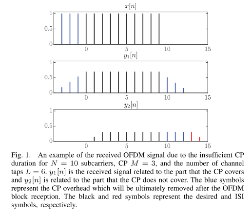
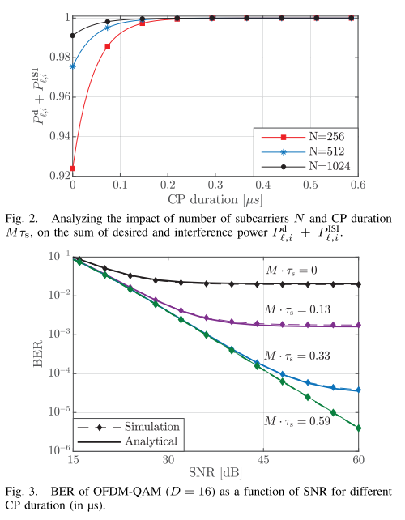
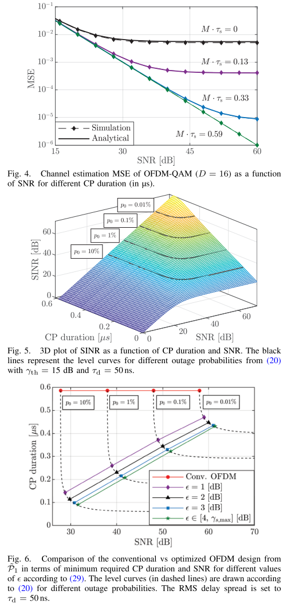
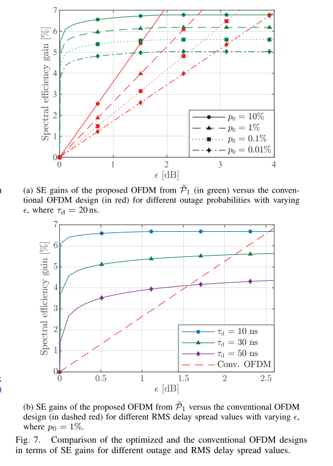
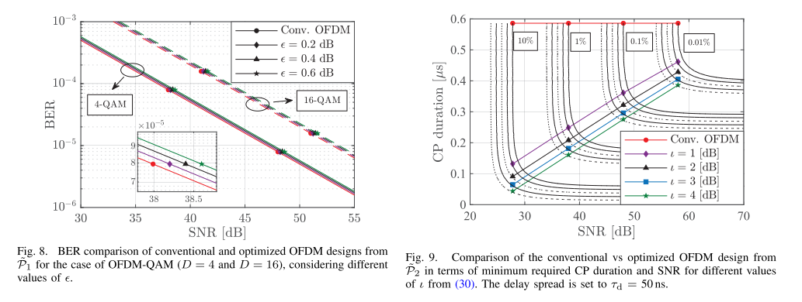
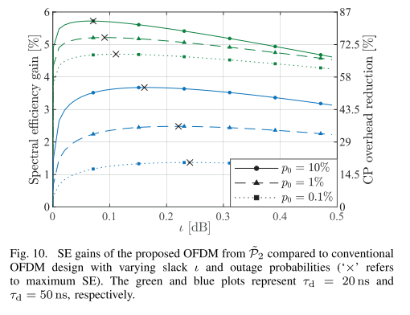
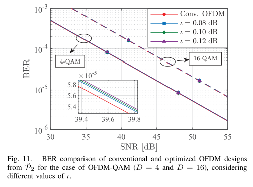

# 6G Waveforms: OFDM Waveform Optimization Design for 6G Industrial Networks [with MATLAB Code]

· We have extended the methods in [33]1 to derive closed-form expressions for the required and ISI power, due to insufficient CP duration. Then, we show that the sum of ISI and required power converges under the assumption of a unified normalized PDP.
· We introduce a multi-objective optimization framework aimed at simultaneously determining the minimum necessary CP duration and SNR for each symbol while adhering to typical key reliability constraints in industrial environments. Subsequently, we address this problem using weighted methods. Moreover, energy efficiency (EE) is emphasized by transforming the proposed multi-objective optimization into a single objective, maintaining the level of transmit power compared to traditional OFDM systems which employ full CP duration.
· We derive least squares (LS) and minimum mean square error (MMSE) channel estimation techniques for optimized OFDM designs with reduced CP duration. Our analysis indicates that both estimation methods have slightly higher mean square error (MSE) than traditional OFDM. This increase in MSE corresponds to the induced ISI power, which is a function of the channel's RMS delay spread. Additionally, we demonstrate that the single tap equalizer method used in traditional OFDM systems remains applicable to the proposed design.
· In summary, our results from two design optimization problems (OP) indicate that reducing CP length is possible based on the channel's RMS delay spread without additional equalization complexity, which translates into an additional gain in SE compared to traditional OFDM.
Conclusion In this paper, we revisit the issue of waveform optimization in industrial settings, focusing on optimizing the CP duration since channels naturally exhibit shorter RMS delay spreads in these environments. Firstly, we analyze the ISI power caused by insufficient CP duration and then demonstrate that MSE increases due to the introduced ISI power under LS channel estimation. We then design a multi-objective OP aimed at jointly minimizing the required SNR and CP duration while ensuring link reliability, employing a weighted sum method to find the optimal solution. Notably, although the designed OP can provide high SE gains, it tends to increase power consumption to compensate for the introduced ISI power. To explain this issue, we propose modifications based on which we limit system power consumption by introducing a relaxation variable.
Our simulation results show that reducing CP duration from 70% to 90% significantly reduces the channel with short to very short RMS delay spreads. The reduction in CP overhead translates into an overall SE increase from 4% to 7%. In summary, the results indicate that OFDM systems with shorter CP durations are feasible in industrial environments and can achieve certain SE gains. Although the current manuscript's analysis is applicable to scenarios with single transmit-receive antennas, extending this analysis to MIMO OFDM scenarios is feasible. The key is to adjust CP duration and beamforming strategies according to the specific characteristics of each physical path while considering the system complexity and operational environment. In conclusion, OFDM with short CPs is particularly beneficial in scenarios where reducing latency, increasing spectral efficiency, and maintaining robust communication under challenging conditions are essential.
Future work should consider the potential for reducing CP overhead in millimeter wave multi-antenna systems. As also validated by various works, such as [49], in these bands, the channel appears frequency flat, allowing almost no overhead transmission.

## Images

<!-- PAYMENT_BLOCK -->

## Get this dataset

- Payment link (Stripe): [Buy now](https://buy.stripe.com/3cs8yP7sY87d0vu9AB)
- Payment QR code: 

<!-- /PAYMENT_BLOCK -->
